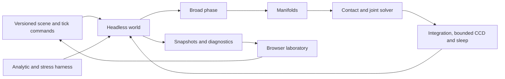

# ImpulseAtlas

CPU rigid-body physics engine and simulation laboratory. Inspect how a two-dimensional world moves, collides and settles. The numerical core owns geometry, contacts, friction, joints and a deliberately bounded continuous-collision path; the browser explains the results without changing them.

**Stage:** requirements and design baseline, 25 November 2026. Product code, benchmark results and runtime acceptance are not delivered or claimed.

Fixed physics ticks and stable constraint ordering determine state. Rendering is separate. Same-build determinism is required; cross-platform bitwise identity and real-world material accuracy are not claimed.

Start with the [documentation guide](docs/README.md), [product scope](docs/requirements/product.md), [high-level design](docs/architecture/high-level-design.md) and [component designs](docs/design/README.md).

[JSON Schemas](schemas/README.md) and [worked examples](examples/README.md) accompany the protocol/data design. Numerical/graph/bytecode artifacts use explicit versioned formats; no unnecessary database dependency is introduced.

Reference direction: C++20 with double-precision scalar CPU math, a small permitted local HTTP adapter, and HTML/CSS/JavaScript with Canvas 2D or SVG. Compiler/library availability remains an environment gate. No existing physics engine supplies the core.

Public repository; [MIT license](LICENSE). [Original input](docs/source/README.md) remains archived. Documentation is AI-assisted; participant-authored submissions and programme approval are separate assessments.
