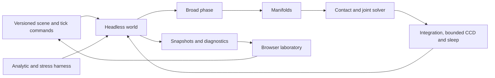

# High-level design

Inspect how a two-dimensional world moves, collides and settles. The numerical core owns geometry, contacts, friction, joints and a deliberately bounded continuous-collision path; the browser explains the results without changing them.

## Core and presentation boundary



Fixed physics ticks and stable constraint ordering determine state. Rendering is separate. Same-build determinism is required; cross-platform bitwise identity and real-world material accuracy are not claimed.

The headless core performs every algorithm and mandatory benchmark without a browser. UI/API adapters serialize bounded state and controls. Inputs, configuration, build and seeds identify each reproducible experiment.

## Main execution sequence

```mermaid
sequenceDiagram
    participant U as Tick-command source
    participant W as World
    participant C as Collision pipeline
    participant S as Constraint solver
    participant P as Presentation
    U->>W: Ordered commands for next tick
    W->>W: Apply forces to velocity
    W->>C: Update proxies; canonical candidate pairs
    C-->>S: Persistent manifolds and joint constraints
    S->>S: Warm start; fixed velocity iterations
    S->>W: Integrate positions; bounded bullet substeps
    W->>S: Refresh geometry; fixed position iterations
    W->>W: Sleep update; finite-state checks; tick commit
    W-->>P: Immutable diagnostic snapshot
    P->>P: Render interpolation without feedback
```

## Components

| Component | Responsibility |
| --- | --- |
| [World stepping commands and handle lifetime](../design/world-clock.md) | Validate scene/config, assign stable slot-plus-generation handles and freeze baseline settings. |
| [Geometry validation mass and compound transforms](../design/geometry.md) | Validate finite vertices, CCW convex winding, nonintersection, positive area and supported sizes. |
| [Sweep-and-prune candidate generation](../design/broad-phase.md) | Maintain X-axis interval endpoints keyed by coordinate, endpoint kind and stable fixture ID. |
| [Narrow phase persistent anchors and feature IDs](../design/manifolds.md) | Handle circle/circle analytically with deterministic normal when centers coincide. |
| [Contact impulses friction and correction](../design/solver.md) | Build effective mass including both inverse masses and lever-arm rotational terms. |
| [Distance and revolute constraints motors and islands](../design/joints.md) | Build distance and two-axis revolute anchor Jacobians with checked effective masses. |
| [Restricted circle time-of-impact substeps](../design/ccd.md) | Sweep a bullet circle against static axis-aligned boxes and static circles only. |
| [Snapshots deterministic diagnostics and replay](../design/snapshots.md) | Capture a tick boundary with complete body/joint state, pending commands and immutable config/build identity. |

## Qualification

1,000 awake dynamic circles/boxes with <=2,000 persistent contact points; p95 headless step <=16.7 ms over 3,600 ticks after 600 warm-up ticks; <=512 MiB application memory. Campaigns: 10,000 small scenes, 1,000 CCD launches and twenty deterministic repeat/continuation runs.

Use analytic motion, elastic circles, sliding friction, ten-box stack, pendulum, ten-link bridge, motor crank and kinematic-platform scenes. Freeze shapes, materials, iterations and settling period before acceptance.

Frozen workloads and independent oracles remain mandatory. Faster-looking rendering or weaker semantics do not satisfy the quantitative bar.
