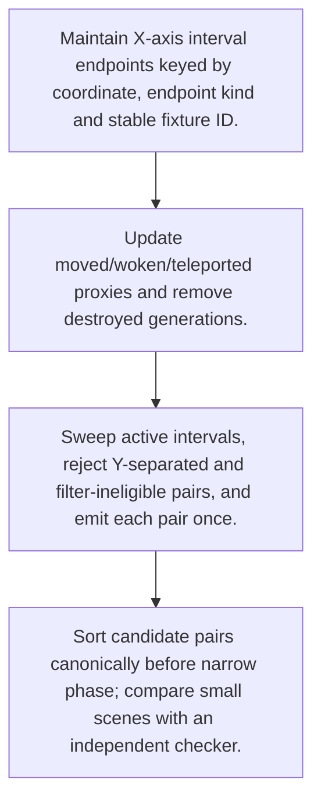

# Sweep-and-prune candidate generation

The selected baseline is sweep-and-prune with deterministic endpoint tie rules: starts before ends so touching candidates are not lost. Dense scenes can be quadratic; report active-sweep work and candidates rather than hiding worst-case behavior. Extra candidates are legal; missed eligible overlaps are not.

## Algorithm

1. Maintain X-axis interval endpoints keyed by coordinate, endpoint kind and stable fixture ID.
2. Update moved/woken/teleported proxies and remove destroyed generations.
3. Sweep active intervals, reject Y-separated and filter-ineligible pairs, and emit each pair once.
4. Sort candidate pairs canonically before narrow phase; compare small scenes with an independent checker.

## Interface and ownership

Inputs are validated immutable domain data plus exact configuration/run/artifact identity. The component returns bounded results or a structured diagnostic with reproducible provenance. No UI action bypasses core validation. [API](../contracts/api.md), [artifact contracts](../contracts/data-and-artifacts.md) and [formats](../../formats/README.md) define the boundary.

## Required behavior

## Broad phase

Implement a dynamic AABB tree or sweep-and-prune structure, with a documented update policy. Maintain stable body/fixture IDs. Emit each candidate pair once, apply collision filters, and process pairs in canonical ID order.

For small random scenes, compare candidates with an independent brute-force pair checker: every truly overlapping eligible pair must appear among candidates. Extra candidates are permitted and counted. Report tree quality or sweep work, candidate count, actual contacts, and update cost.

Moving, destroying, waking, or teleporting a body must update the broad phase correctly. Recycled handles carry generations so a deleted body cannot be confused with a newly allocated one.

## Failure and verification

Partial artifacts never become selected outputs. Numerical/resource/cost/bytecode errors preserve their fixture and location rather than fabricate a plausible answer. Independent oracles must not call the production implementation being evaluated. See [harness and fixtures](../testing/harness-and-fixtures.md) and [acceptance](../testing/acceptance-plan.md). All runtime outcomes remain NOT RUN.
