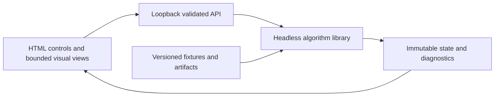

# Browser and local API modules

Use small modules for API, exact identity/state, controls, visualization and inspector pagination. Painting/culling/editor changes never alter core algorithm ordering or results. Local controllers enforce finite tick/query/instruction work per request and expose cancellation at safe boundaries.

## Browser laboratory

Provide a local HTML/CSS/JavaScript UI using SVG or Canvas 2D. The core runs on CPU; no WebGL, WebGPU, GPU compute, game engine, native window toolkit, or sound is required. If Canvas uses browser acceleration internally, the application must still run with software rendering.

Required screens/tools: scene selector, play/pause/single-step, body inspector, force/impulse tool, contact normals and points, broad-phase bounds, joint anchors, energy/momentum charts, residual/penetration plots, profiler, snapshot controls, and test report viewer.

Show simulated tick/time separately from wall-clock playback. Dragging a body either uses an explicitly modeled joint or submits a labeled teleport command; it cannot secretly overwrite solver state. Display active CCD scope and numerical warnings. All assets are generated geometric shapes and local text.

All mutation/control replies identify the accepted run/artifact and source revision. Handle errors and stale state visibly. Requests are not retried as fresh intent after an unknown outcome; stable control identity/status resolves uncertainty where needed. The future UI must call actual core APIs; this repository supplies its design, not fabricated progress.
