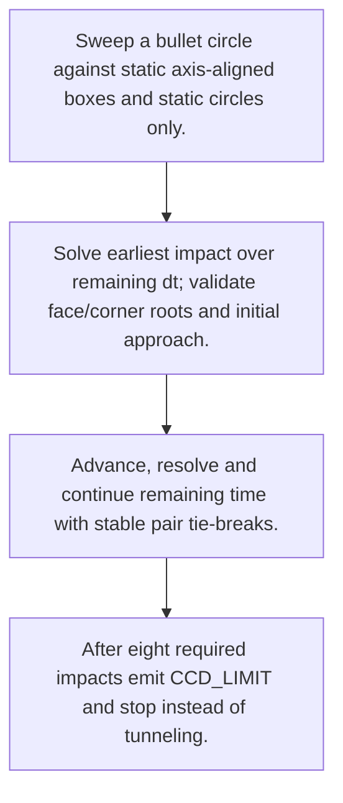

# Restricted circle time-of-impact substeps

For a box, expanded face slabs alone are insufficient at rounded corners: test valid face regions plus circle-vs-corner quadratic roots. Static-circle TOI solves the relative center quadratic using summed radii. Tangent/moving-away starts must not create repeated zero-time impacts. Bullet positions are not integrated again by the ordinary discrete path.

## Algorithm

1. Sweep a bullet circle against static axis-aligned boxes and static circles only.
2. Solve earliest impact over remaining dt; validate face/corner roots and initial approach.
3. Advance, resolve and continue remaining time with stable pair tie-breaks.
4. After eight required impacts emit CCD_LIMIT and stop instead of tunneling.

## Interface and ownership

Inputs are validated immutable domain data plus exact configuration/run/artifact identity. The component returns bounded results or a structured diagnostic with reproducible provenance. No UI action bypasses core validation. [API](../contracts/api.md), [artifact contracts](../contracts/data-and-artifacts.md) and [formats](../../formats/README.md) define the boundary.

## Required behavior

## Continuous collision detection

The mandatory CCD scope is a moving circle against static axis-aligned boxes and static circles. Ordinary polygon motion remains discrete and is labeled accordingly. Do not imply that every shape pair has CCD.

Compute time of impact over the remaining tick, advance to the earliest valid impact, resolve contact, and process the remaining time with a bounded event count. Handle grazing corners, initially touching/separating shapes, and simultaneous impacts with stable tie-breaking.

If more than eight CCD impacts are required in a tick, return an explicit `CCD_LIMIT` diagnostic and stop that run instead of letting the object pass through a wall. Test 1,000 generated launches at up to 150 m/s against walls as thin as 0.05 m. Report zero tunneling for this supported fixture family and expected no-impact results for grazing misses.

## Failure and verification

Partial artifacts never become selected outputs. Numerical/resource/cost/bytecode errors preserve their fixture and location rather than fabricate a plausible answer. Independent oracles must not call the production implementation being evaluated. See [harness and fixtures](../testing/harness-and-fixtures.md) and [acceptance](../testing/acceptance-plan.md). All runtime outcomes remain NOT RUN.

## Swept candidate coverage

The bullet path queries static candidates using the union of start/end AABBs over remaining time, expanded by the circle radius/declared skin. Ordinary current-position broad-phase pairs alone can miss a thin wall. Input velocity permits up to 150 m/s for the explicit bullet fixture; the core enforces ordinary 50 m/s and bullet scope semantically without silent clamping.
