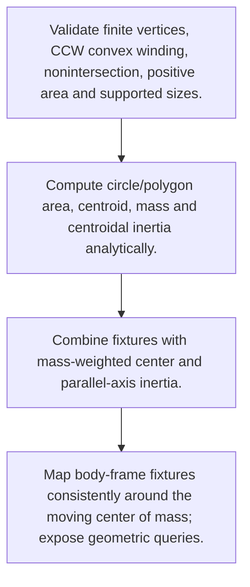

# Geometry validation mass and compound transforms

The scene transform is body-frame origin, while velocity/inertia integration uses center of mass. Static/kinematic inverse mass and inertia are zero. Dynamic computed mass must lie in the supported 0.1–1,000 kg range. Deterministic fallbacks handle coincident centers and parallel edges.

## Algorithm

1. Validate finite vertices, CCW convex winding, nonintersection, positive area and supported sizes.
2. Compute circle/polygon area, centroid, mass and centroidal inertia analytically.
3. Combine fixtures with mass-weighted center and parallel-axis inertia.
4. Map body-frame fixtures consistently around the moving center of mass; expose geometric queries.

## Interface and ownership

Inputs are validated immutable domain data plus exact configuration/run/artifact identity. The component returns bounded results or a structured diagnostic with reproducible provenance. No UI action bypasses core validation. [API](../contracts/api.md), [artifact contracts](../contracts/data-and-artifacts.md) and [formats](../../formats/README.md) define the boundary.

## Required behavior

## Geometry and mass properties

Compute area, center of mass, mass, and inertia for circles and convex polygons; combine compound fixtures using the parallel-axis theorem. External body transforms describe the body frame, while dynamics advance its center of mass consistently.

Implement point containment, AABB calculation, segment/ray queries, and shape overlap queries with documented boundary behavior. Normals must have consistent direction. Coincident circle centers and nearly parallel edges require deterministic fallback rules rather than division by zero.

Use hand-calculated shapes and transformed copies as fixtures. Rotation/translation of a valid shape should preserve mass and inertia about its own center. Geometry validation cannot depend on whichever order a hash map returns vertices.

## Failure and verification

Partial artifacts never become selected outputs. Numerical/resource/cost/bytecode errors preserve their fixture and location rather than fabricate a plausible answer. Independent oracles must not call the production implementation being evaluated. See [harness and fixtures](../testing/harness-and-fixtures.md) and [acceptance](../testing/acceptance-plan.md). All runtime outcomes remain NOT RUN.
