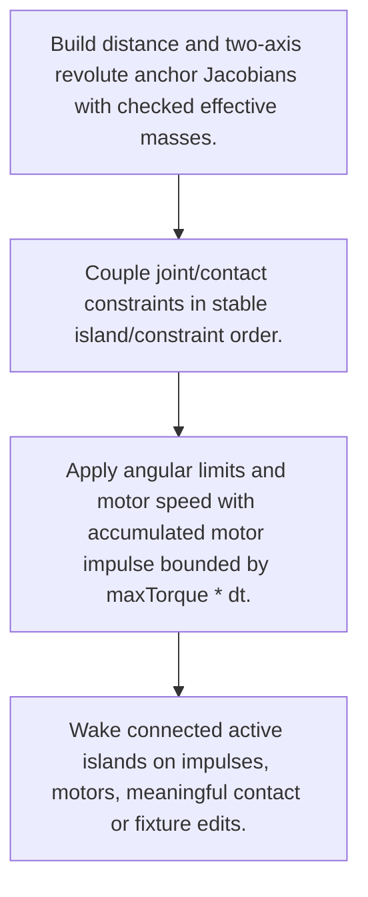

# Distance and revolute constraints motors and islands

Distance rest length is fixed. Connected-body collision is an explicit joint flag. Reject immovable/singular constraints requiring motion. Sleeping counters use ticks and fixed thresholds; static geometry remains queryable and sleeping bodies remain wakeable.

## Algorithm

1. Build distance and two-axis revolute anchor Jacobians with checked effective masses.
2. Couple joint/contact constraints in stable island/constraint order.
3. Apply angular limits and motor speed with accumulated motor impulse bounded by maxTorque * dt.
4. Wake connected active islands on impulses, motors, meaningful contact or fixture edits.

## Interface and ownership

Inputs are validated immutable domain data plus exact configuration/run/artifact identity. The component returns bounded results or a structured diagnostic with reproducible provenance. No UI action bypasses core validation. [API](../contracts/api.md), [artifact contracts](../contracts/data-and-artifacts.md) and [formats](../../formats/README.md) define the boundary.

## Required behavior

## Joints and mechanical interactions

Implement distance joints with a fixed rest length and revolute joints with anchor constraints, optional angular limits, and optional motor target speed/max torque. Enforce motor limits through accumulated impulses rather than unbounded corrective forces.

Reject singular configurations that cannot be solved under the supported model, such as a meaningful movable constraint between two immovable bodies. Define whether connected bodies collide. Waking one body through an applied impulse or motor change must wake the connected active island as needed.

Required compound scenes include a pendulum, a hinged bridge with ten links, a motor-driven crank, and a stack interacting with a moving kinematic platform. These exercise solver coupling beyond isolated demonstration objects.

## Failure and verification

Partial artifacts never become selected outputs. Numerical/resource/cost/bytecode errors preserve their fixture and location rather than fabricate a plausible answer. Independent oracles must not call the production implementation being evaluated. See [harness and fixtures](../testing/harness-and-fixtures.md) and [acceptance](../testing/acceptance-plan.md). All runtime outcomes remain NOT RUN.
