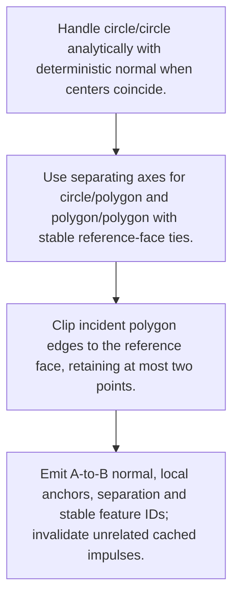

# Narrow phase persistent anchors and feature IDs

Touching within documented skin/slop creates a contact candidate under one normal policy. Polygon feature IDs encode reference/incident edges or vertices plus fixture generations; they are not array position after clipping. Containment, corner grazing and near-parallel cases have hand-calculated fixtures.

## Algorithm

1. Handle circle/circle analytically with deterministic normal when centers coincide.
2. Use separating axes for circle/polygon and polygon/polygon with stable reference-face ties.
3. Clip incident polygon edges to the reference face, retaining at most two points.
4. Emit A-to-B normal, local anchors, separation and stable feature IDs; invalidate unrelated cached impulses.

## Interface and ownership

Inputs are validated immutable domain data plus exact configuration/run/artifact identity. The component returns bounded results or a structured diagnostic with reproducible provenance. No UI action bypasses core validation. [API](../contracts/api.md), [artifact contracts](../contracts/data-and-artifacts.md) and [formats](../../formats/README.md) define the boundary.

## Required behavior

## Narrow phase and manifolds

Required shape combinations are circle/circle, circle/polygon, and polygon/polygon. A separating-axis and clipping implementation is suitable for convex polygons; choose and document the actual algorithm.

Produce contact normals, separation/penetration, local anchors, and persistent feature identifiers. Polygon contacts support up to two points. Contact identity survives ordinary small motion so warm starting is meaningful; invalidated features cannot retain unrelated impulses.

Specify collision skin/slop, touch-versus-overlap behavior, and normal orientation. Tests cover edge contact, vertex contact, nearly parallel faces, containment, duplicate points rejected at import, and transitions between manifold types.

## Failure and verification

Partial artifacts never become selected outputs. Numerical/resource/cost/bytecode errors preserve their fixture and location rather than fabricate a plausible answer. Independent oracles must not call the production implementation being evaluated. See [harness and fixtures](../testing/harness-and-fixtures.md) and [acceptance](../testing/acceptance-plan.md). All runtime outcomes remain NOT RUN.
