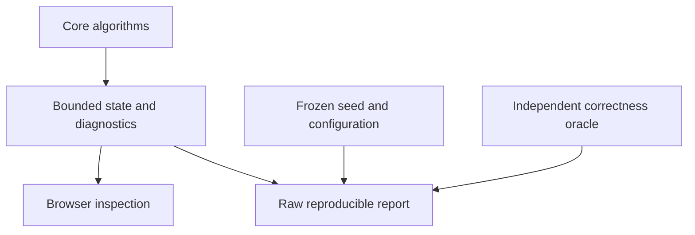

# Diagnostics and measurement

Record physics tick/time separately from render/wall time, awake bodies, candidate/contact counts, solver residual, penetration, energy assumptions, joint error, CCD impacts and nonfinite locations.

Include hardware/runtime/build, seed, precision/overflow policy, complete fixture and five repetitions where specified. Keep complete latency distributions and failed/incomplete runs. Profiling does not replace the oracle; a faster incorrect answer is a failure. Benchmark verification/GC/core work is timed according to the required workload, not silently excluded.
