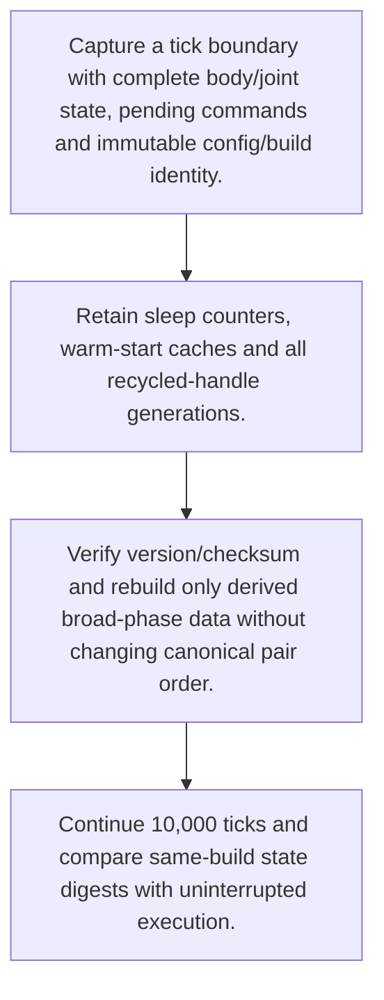

# Snapshots deterministic diagnostics and replay

Hash IEEE-754 values in a declared byte order; reject nonfinite state and normalize negative zero consistently if that is the format policy. Reports and rendering timestamps are outside the numerical digest. Sleep/cache state is not omitted merely because it is not drawn.

## Algorithm

1. Capture a tick boundary with complete body/joint state, pending commands and immutable config/build identity.
2. Retain sleep counters, warm-start caches and all recycled-handle generations.
3. Verify version/checksum and rebuild only derived broad-phase data without changing canonical pair order.
4. Continue 10,000 ticks and compare same-build state digests with uninterrupted execution.

## Interface and ownership

Inputs are validated immutable domain data plus exact configuration/run/artifact identity. The component returns bounded results or a structured diagnostic with reproducible provenance. No UI action bypasses core validation. [API](../contracts/api.md), [artifact contracts](../contracts/data-and-artifacts.md) and [formats](../../formats/README.md) define the boundary.

## Required behavior

## Sleeping, determinism, and snapshots

Sleeping uses fixed velocity thresholds and tick counts, not wall time. Bodies wake on meaningful contact, joint interaction, impulses, or fixture changes. A sleeping body still participates in relevant overlap queries and can be awakened correctly.

Require identical state digests for repeated runs using the same executable/runtime, configuration, scene, and command sequence. Do not claim bitwise determinism across compilers, CPU architectures, or runtimes. Stable pair/constraint ordering and seeded randomness are mandatory.

A snapshot includes tick, body/joint state, sleep counters, persistent contact/warm-start caches, handle generations, configuration, and pending commands. Restore must reproduce uninterrupted execution for 10,000 subsequent ticks. Derived broad-phase data may be rebuilt only if canonical processing order remains unchanged. Corrupt or incompatible snapshots fail clearly.

## Failure and verification

Partial artifacts never become selected outputs. Numerical/resource/cost/bytecode errors preserve their fixture and location rather than fabricate a plausible answer. Independent oracles must not call the production implementation being evaluated. See [harness and fixtures](../testing/harness-and-fixtures.md) and [acceptance](../testing/acceptance-plan.md). All runtime outcomes remain NOT RUN.
