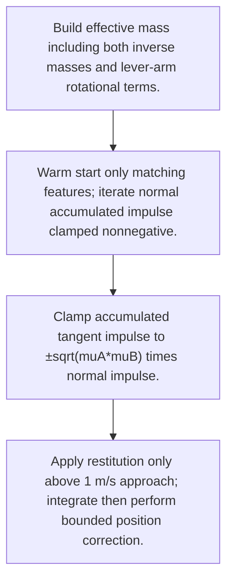

# Contact impulses friction and correction

Use maximum restitution mixing. Proposed frozen baseline is eight velocity and three position iterations, warm start on, 5 mm linear slop and 0.2 m maximum per-iteration positional correction. These are proposed settings, not a measured stability guarantee; fixture changes require a versioned benchmark manifest.

## Algorithm

1. Build effective mass including both inverse masses and lever-arm rotational terms.
2. Warm start only matching features; iterate normal accumulated impulse clamped nonnegative.
3. Clamp accumulated tangent impulse to ±sqrt(muA*muB) times normal impulse.
4. Apply restitution only above 1 m/s approach; integrate then perform bounded position correction.

## Interface and ownership

Inputs are validated immutable domain data plus exact configuration/run/artifact identity. The component returns bounded results or a structured diagnostic with reproducible provenance. No UI action bypasses core validation. [API](../contracts/api.md), [artifact contracts](../contracts/data-and-artifacts.md) and [formats](../../formats/README.md) define the boundary.

## Required behavior

## Contact solver

Implement an iterative sequential-impulse solver with accumulated normal and friction impulses, warm starting, rotational effects, restitution, and bounded positional correction. Normal impulses cannot attract separating bodies. Tangential impulse magnitude is bounded by the chosen friction coefficient times accumulated normal impulse.

Use geometric-mean friction mixing and maximum restitution mixing for the first release. Disable restitution below a documented 1 m/s normal approach threshold to reduce resting jitter. Record these policies in scene metadata.

Use stable constraint ordering and fixed iteration counts for deterministic baseline runs. Expose velocity and position iterations, warm-starting mode, residuals, and penetration statistics. Position correction must not inject unbounded energy. Any numerical failure identifies the tick, body pair/joint, and nonfinite value.

## Failure and verification

Partial artifacts never become selected outputs. Numerical/resource/cost/bytecode errors preserve their fixture and location rather than fabricate a plausible answer. Independent oracles must not call the production implementation being evaluated. See [harness and fixtures](../testing/harness-and-fixtures.md) and [acceptance](../testing/acceptance-plan.md). All runtime outcomes remain NOT RUN.
