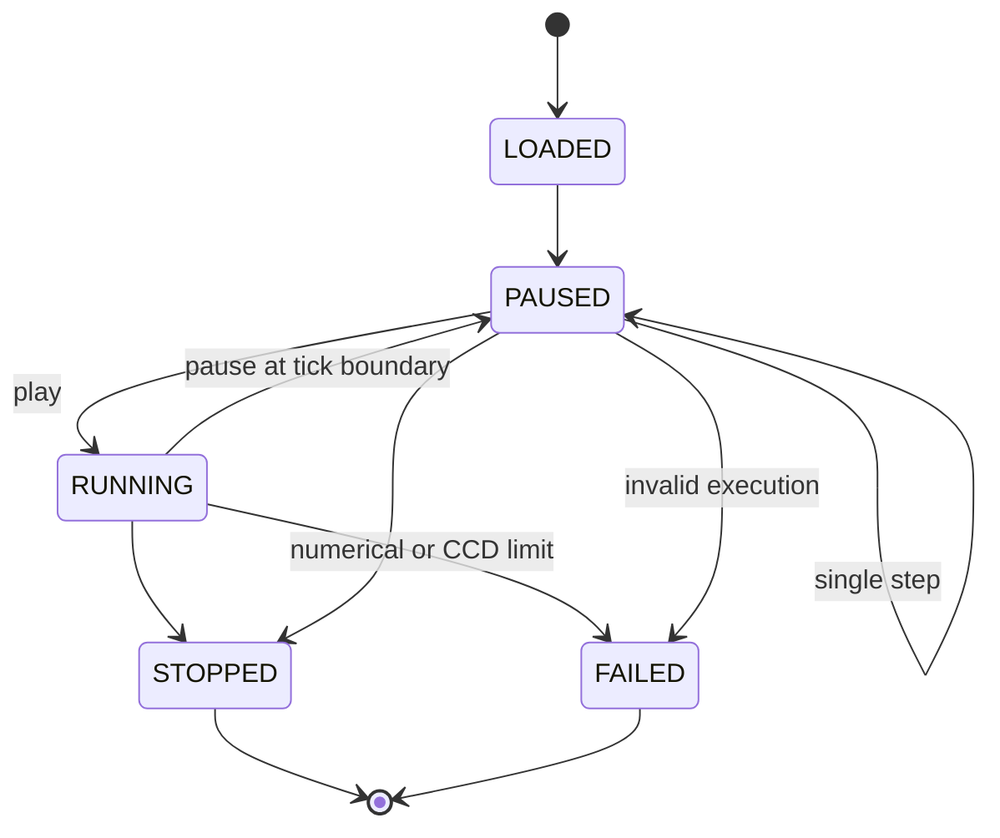

# Run and artifact state machines

A UI label cannot turn a failed run or incomplete artifact into a completed result. Every action carries current run/build/profile identity. Restart/restore uses the documented boundary rather than guessing old handles or silently replacing the artifact.

Pause/step acts at tick boundaries; render interpolation is observational. Failed numerical state has an explicit tick and pair/joint.
