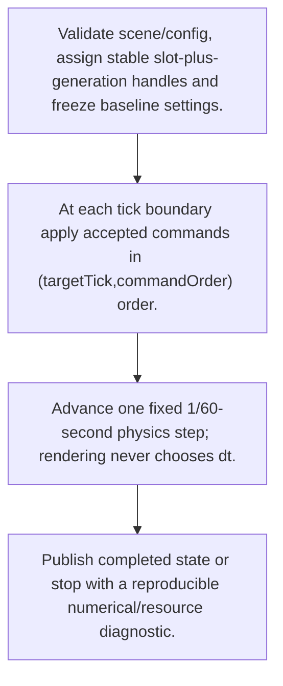

# World stepping commands and handle lifetime

Past-tick commands are rejected. Restoring an earlier snapshot creates a new run identity with retained command provenance. Destroy invalidates generations and clears affected contacts/joints/proxies; reuse cannot revive old handles. A failed tick stops the run and is not presented as a clean completed sample.

## Algorithm

1. Validate scene/config, assign stable slot-plus-generation handles and freeze baseline settings.
2. At each tick boundary apply accepted commands in (targetTick,commandOrder) order.
3. Advance one fixed 1/60-second physics step; rendering never chooses dt.
4. Publish completed state or stop with a reproducible numerical/resource diagnostic.

## Interface and ownership

Inputs are validated immutable domain data plus exact configuration/run/artifact identity. The component returns bounded results or a structured diagnostic with reproducible provenance. No UI action bypasses core validation. [API](../contracts/api.md), [artifact contracts](../contracts/data-and-artifacts.md) and [formats](../../formats/README.md) define the boundary.

## Required behavior

## Units, numerical domain, and validity

Use meters, kilograms, seconds, radians, and double-precision floating point. The supported scene domain is a 200 m by 200 m region, fixture sizes from 0.05 m to 10 m, masses from 0.1 kg to 1,000 kg, and ordinary speeds up to 50 m/s. Explicit bullet fixtures may reach 150 m/s in CCD tests.

Validate finite coordinates, positive mass/density, nonnegative friction, restitution in [0,1], convexity, vertex order, area, and joint parameters. Reject self-intersections, degenerate polygons, and invalid inertia. Define one documented tolerance policy with units; do not use an unexplained epsilon everywhere.

The benchmark settings are fixed before measurement. Do not silently reduce iterations, clamp velocities, remove bodies, or disable contacts to make a difficult scene meet a timing bar. If a resource/numerical limit is reached, report the limit and mark the run failed or incomplete.

## Simulation clock and input semantics

The reference configuration advances at a fixed timestep of 1/60 second. Use semi-implicit Euler for unconstrained integration: update velocity from forces, then advance positions using the new velocity, within the documented contact/constraint step ordering.

Wall-clock rendering does not determine physics timestep. The browser may interpolate for display, but interpolated state is never fed back into simulation. A slow machine may run behind real time; it must not skip physics ticks silently.

Every mutation command has a target tick and stable command order. Commands include create/destroy body, set kinematic motion, apply force, apply impulse, create/destroy joint, and change supported material parameters. Apply them at tick boundaries. Reject commands for completed ticks unless the user explicitly restores an earlier snapshot and starts a new run.

## Sleeping, determinism, and snapshots

Sleeping uses fixed velocity thresholds and tick counts, not wall time. Bodies wake on meaningful contact, joint interaction, impulses, or fixture changes. A sleeping body still participates in relevant overlap queries and can be awakened correctly.

Require identical state digests for repeated runs using the same executable/runtime, configuration, scene, and command sequence. Do not claim bitwise determinism across compilers, CPU architectures, or runtimes. Stable pair/constraint ordering and seeded randomness are mandatory.

A snapshot includes tick, body/joint state, sleep counters, persistent contact/warm-start caches, handle generations, configuration, and pending commands. Restore must reproduce uninterrupted execution for 10,000 subsequent ticks. Derived broad-phase data may be rebuilt only if canonical processing order remains unchanged. Corrupt or incompatible snapshots fail clearly.

## Failure and verification

Partial artifacts never become selected outputs. Numerical/resource/cost/bytecode errors preserve their fixture and location rather than fabricate a plausible answer. Independent oracles must not call the production implementation being evaluated. See [harness and fixtures](../testing/harness-and-fixtures.md) and [acceptance](../testing/acceptance-plan.md). All runtime outcomes remain NOT RUN.
