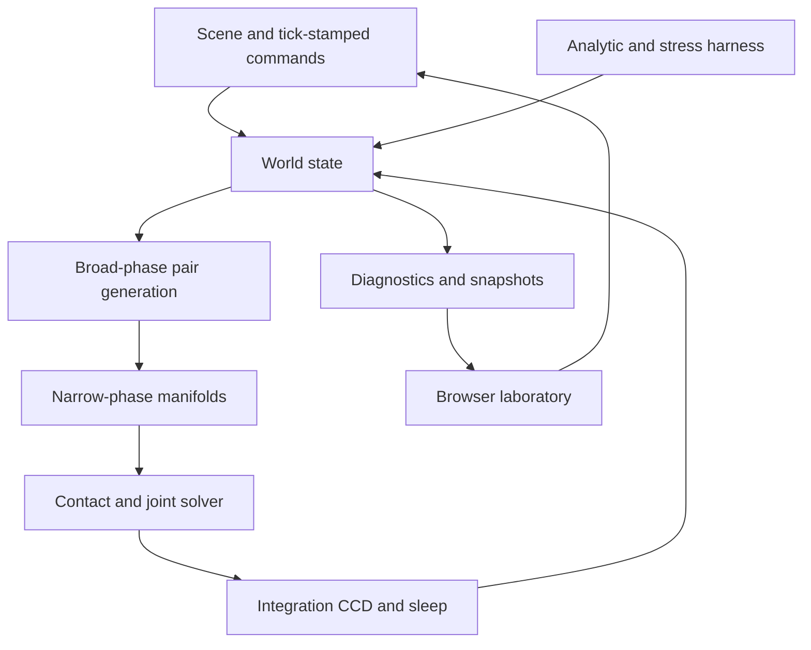

# ImpulseAtlas — CPU Rigid-Body Physics Engine and Simulation Laboratory

Version 1.0 · 25 November 2026 · Proposed requirements. No implementation, performance result, or completed acceptance test is claimed.

## 1. Purpose

Build a two-dimensional rigid-body physics engine from its numerical core outward. It must detect contacts, resolve collision impulses and friction, enforce mechanical joints, handle a bounded continuous-collision case, and reproduce experiments from tick-stamped inputs. A local browser laboratory will show bodies, contacts, forces, constraints, and numerical errors.

The intended users are developers building small simulations and engineers who want to inspect why a mechanical scene behaves as it does. The central challenge is making interacting approximations remain stable: a collision solver may look convincing for two circles yet fail badly when many bodies stack, joints pull against contacts, or a fast object crosses a thin wall.

This is a numerical simulation and computational geometry project. It is independent of all earlier workflow, messaging, replay, synchronization, gateway, reservation, consensus, streaming, and index-rebuild concepts.

## 2. Ownership and program status

This is an AI-assisted reference proposal. It does not establish that the participant independently originated the project, owns future code, or has program approval. The supplied rules exclude AI-invented projects and require the participant's own answers. Resolve that point with the project contact before submitting; program development sessions begin only after approval.

Use generated scenes and owned geometry only. No employer data, private recordings, commercial game assets, real accounts, AI models, production systems, or external services are needed. This is not a safety-certified engineering simulator or a claim of real-world material accuracy.

## 3. End state and core ownership

Deliver a reusable simulation library, headless runner, scene format, geometry routines, broad phase, contact manifold generation, iterative impulse solver, joint solver, restricted CCD path, deterministic command playback, snapshots, analytic/reference tests, profiling harness, and browser laboratory.

The engine must implement its own collision and constraint algorithms. Wrapping Box2D, Matter.js, a game engine, or a physics service does not meet the goal. Standard math, JSON, HTTP, and collection libraries are acceptable. Reference engines may inform tests if available, but cannot be required to run the project offline.

## 4. Required scope

Required: static, kinematic, and dynamic bodies; circles; convex polygons with three to eight vertices; compound bodies made of fixtures; mass and rotational inertia; gravity; forces and impulses; collision filtering; broad-phase acceleration; persistent contacts; restitution; Coulomb friction; distance and revolute joints; motor limits; sleeping/waking; fixed-step simulation; circle-versus-static CCD; and inspectable diagnostics.

Deferred: 3D, soft bodies, fluids, deformable materials, fracture, general concave polygon collision, arbitrary dynamic-versus-dynamic CCD, GPU computation, parallel solving, networked multiplayer, and real sound. The first release favors a well-tested CPU solver over a long list of unsupported shape types.

## 5. Units, numerical domain, and validity

Use meters, kilograms, seconds, radians, and double-precision floating point. The supported scene domain is a 200 m by 200 m region, fixture sizes from 0.05 m to 10 m, masses from 0.1 kg to 1,000 kg, and ordinary speeds up to 50 m/s. Explicit bullet fixtures may reach 150 m/s in CCD tests.

Validate finite coordinates, positive mass/density, nonnegative friction, restitution in [0,1], convexity, vertex order, area, and joint parameters. Reject self-intersections, degenerate polygons, and invalid inertia. Define one documented tolerance policy with units; do not use an unexplained epsilon everywhere.

The benchmark settings are fixed before measurement. Do not silently reduce iterations, clamp velocities, remove bodies, or disable contacts to make a difficult scene meet a timing bar. If a resource/numerical limit is reached, report the limit and mark the run failed or incomplete.

## 6. Simulation clock and input semantics

The reference configuration advances at a fixed timestep of 1/60 second. Use semi-implicit Euler for unconstrained integration: update velocity from forces, then advance positions using the new velocity, within the documented contact/constraint step ordering.

Wall-clock rendering does not determine physics timestep. The browser may interpolate for display, but interpolated state is never fed back into simulation. A slow machine may run behind real time; it must not skip physics ticks silently.

Every mutation command has a target tick and stable command order. Commands include create/destroy body, set kinematic motion, apply force, apply impulse, create/destroy joint, and change supported material parameters. Apply them at tick boundaries. Reject commands for completed ticks unless the user explicitly restores an earlier snapshot and starts a new run.

## 7. Architecture

The numerical core must run headlessly. Rendering, browser refresh, and report generation cannot affect contact ordering or simulation results. Keep a clear API between world stepping and presentation.

## 8. Geometry and mass properties

Compute area, center of mass, mass, and inertia for circles and convex polygons; combine compound fixtures using the parallel-axis theorem. External body transforms describe the body frame, while dynamics advance its center of mass consistently.

Implement point containment, AABB calculation, segment/ray queries, and shape overlap queries with documented boundary behavior. Normals must have consistent direction. Coincident circle centers and nearly parallel edges require deterministic fallback rules rather than division by zero.

Use hand-calculated shapes and transformed copies as fixtures. Rotation/translation of a valid shape should preserve mass and inertia about its own center. Geometry validation cannot depend on whichever order a hash map returns vertices.

## 9. Broad phase

Implement a dynamic AABB tree or sweep-and-prune structure, with a documented update policy. Maintain stable body/fixture IDs. Emit each candidate pair once, apply collision filters, and process pairs in canonical ID order.

For small random scenes, compare candidates with an independent brute-force pair checker: every truly overlapping eligible pair must appear among candidates. Extra candidates are permitted and counted. Report tree quality or sweep work, candidate count, actual contacts, and update cost.

Moving, destroying, waking, or teleporting a body must update the broad phase correctly. Recycled handles carry generations so a deleted body cannot be confused with a newly allocated one.

## 10. Narrow phase and manifolds

Required shape combinations are circle/circle, circle/polygon, and polygon/polygon. A separating-axis and clipping implementation is suitable for convex polygons; choose and document the actual algorithm.

Produce contact normals, separation/penetration, local anchors, and persistent feature identifiers. Polygon contacts support up to two points. Contact identity survives ordinary small motion so warm starting is meaningful; invalidated features cannot retain unrelated impulses.

Specify collision skin/slop, touch-versus-overlap behavior, and normal orientation. Tests cover edge contact, vertex contact, nearly parallel faces, containment, duplicate points rejected at import, and transitions between manifold types.

## 11. Contact solver

Implement an iterative sequential-impulse solver with accumulated normal and friction impulses, warm starting, rotational effects, restitution, and bounded positional correction. Normal impulses cannot attract separating bodies. Tangential impulse magnitude is bounded by the chosen friction coefficient times accumulated normal impulse.

Use geometric-mean friction mixing and maximum restitution mixing for the first release. Disable restitution below a documented 1 m/s normal approach threshold to reduce resting jitter. Record these policies in scene metadata.

Use stable constraint ordering and fixed iteration counts for deterministic baseline runs. Expose velocity and position iterations, warm-starting mode, residuals, and penetration statistics. Position correction must not inject unbounded energy. Any numerical failure identifies the tick, body pair/joint, and nonfinite value.

## 12. Joints and mechanical interactions

Implement distance joints with a fixed rest length and revolute joints with anchor constraints, optional angular limits, and optional motor target speed/max torque. Enforce motor limits through accumulated impulses rather than unbounded corrective forces.

Reject singular configurations that cannot be solved under the supported model, such as a meaningful movable constraint between two immovable bodies. Define whether connected bodies collide. Waking one body through an applied impulse or motor change must wake the connected active island as needed.

Required compound scenes include a pendulum, a hinged bridge with ten links, a motor-driven crank, and a stack interacting with a moving kinematic platform. These exercise solver coupling beyond isolated demonstration objects.

## 13. Continuous collision detection

The mandatory CCD scope is a moving circle against static axis-aligned boxes and static circles. Ordinary polygon motion remains discrete and is labeled accordingly. Do not imply that every shape pair has CCD.

Compute time of impact over the remaining tick, advance to the earliest valid impact, resolve contact, and process the remaining time with a bounded event count. Handle grazing corners, initially touching/separating shapes, and simultaneous impacts with stable tie-breaking.

If more than eight CCD impacts are required in a tick, return an explicit `CCD_LIMIT` diagnostic and stop that run instead of letting the object pass through a wall. Test 1,000 generated launches at up to 150 m/s against walls as thin as 0.05 m. Report zero tunneling for this supported fixture family and expected no-impact results for grazing misses.

## 14. Sleeping, determinism, and snapshots

Sleeping uses fixed velocity thresholds and tick counts, not wall time. Bodies wake on meaningful contact, joint interaction, impulses, or fixture changes. A sleeping body still participates in relevant overlap queries and can be awakened correctly.

Require identical state digests for repeated runs using the same executable/runtime, configuration, scene, and command sequence. Do not claim bitwise determinism across compilers, CPU architectures, or runtimes. Stable pair/constraint ordering and seeded randomness are mandatory.

A snapshot includes tick, body/joint state, sleep counters, persistent contact/warm-start caches, handle generations, configuration, and pending commands. Restore must reproduce uninterrupted execution for 10,000 subsequent ticks. Derived broad-phase data may be rebuilt only if canonical processing order remains unchanged. Corrupt or incompatible snapshots fail clearly.

## 15. Browser laboratory

Provide a local HTML/CSS/JavaScript UI using SVG or Canvas 2D. The core runs on CPU; no WebGL, WebGPU, GPU compute, game engine, native window toolkit, or sound is required. If Canvas uses browser acceleration internally, the application must still run with software rendering.

Required screens/tools: scene selector, play/pause/single-step, body inspector, force/impulse tool, contact normals and points, broad-phase bounds, joint anchors, energy/momentum charts, residual/penetration plots, profiler, snapshot controls, and test report viewer.

Show simulated tick/time separately from wall-clock playback. Dragging a body either uses an explicitly modeled joint or submits a labeled teleport command; it cannot secretly overwrite solver state. Display active CCD scope and numerical warnings. All assets are generated geometric shapes and local text.

## 16. Scene, API, and data contracts

Versioned JSON scenes contain world settings, materials, body/fixture definitions, joints, and deterministic command scripts. A run retains the scene hash, configuration hash, engine build, seed, commands, snapshots, and measurements.

The local API supports create world, load scene, submit tick commands, advance N ticks, pause/run, inspect bounded state, inspect contacts/joints, save/restore snapshot, run a named test, and retrieve a report. Suggested routes are `/worlds`, `/worlds/{id}/commands`, `/worlds/{id}/steps`, `/worlds/{id}/state`, `/worlds/{id}/snapshots`, and `/reports`.

Bound body count, fixtures per body, joint count, command backlog, ticks per request, snapshot bytes, and diagnostic history. Return structured validation, stale-handle, numerical-failure, resource-limit, and stopped-run errors. The service binds to loopback and controls no external process or system.

## 17. Analytic correctness and tolerances

Use independent checks rather than treating another engine's trajectory as exact truth. Required fixtures include constant-velocity motion, discrete free fall, circle collision, rest on a flat static box, sliding friction, pendulum/joint length, and CCD time of impact.

For free fall with no contacts, compare against the closed-form semi-implicit recurrence to 1e-8 m over 60 ticks. Also compare with continuous motion and verify that halving timestep approximately halves first-order position error, within a declared 10% ratio tolerance away from roundoff.

For isolated equal-mass elastic head-on circles with gravity/friction disabled, final velocities match analytic values within 1e-3 m/s, momentum relative error is at most 1e-6, and kinetic-energy relative error is at most 1%. Energy conservation is not required in inelastic, frictional, powered, or kinematically driven scenes.

For the fixed bridge/pendulum fixtures, joint-length error is at most 0.02 m after 2,000 ticks. A ten-box resting stack must remain bounded for 10,000 ticks, with maximum penetration at most 0.02 m after settling. Freeze the exact fixture dimensions, iterations, and settling period before acceptance.

## 18. Local scale and performance

| Workload | Proposed pass bar |
| --- | --- |
| Real-time scene | 1,000 awake dynamic circles/boxes, at most 2,000 persistent contact points, fixed 60 Hz configuration |
| Tick cost | p95 headless physics time at most 16.7 ms over 3,600 measured ticks after 600 warm-up ticks |
| Small-scene geometry campaign | 10,000 seeded scenes of at most 100 fixtures; broad phase misses zero eligible overlaps |
| CCD campaign | 1,000 supported fast-circle launches; zero tunneling and correct miss classification |
| Mechanical suite | Four required compound scenes, including ten-link bridge and motor interaction |
| Determinism | Twenty repeated runs and snapshot continuations produce matching same-build digests |
| Memory | At most 512 MiB application memory for the mandatory 1,000-body scene, excluding browser/OS |
| Soak | 30 minutes of simulated stepping with controlled create/destroy cycles; zero nonfinite states or unbounded retained handles |

These are proposed thresholds, not results. Report hardware, runtime, precision, iterations, awake bodies, actual contacts, CCD work, memory, and the entire timing distribution. Rendering cost is measured separately and never substituted for physics cost. A 5,000-body scene is a stretch benchmark with an honest reported result, not a required real-time promise.

## 19. Acceptance catalog

All items start **NOT RUN**.

| ID | Required evidence |
| --- | --- |
| IA-01 | Geometry validation and mass/inertia fixtures pass |
| IA-02 | Broad phase finds every overlap in 10,000 seeded small scenes |
| IA-03 | All three mandatory shape-pair combinations produce expected manifolds |
| IA-04 | Stable feature IDs and warm-start cache invalidation survive contact transitions |
| IA-05 | Analytic motion, collision, momentum, and energy tests meet stated tolerances |
| IA-06 | Resting stack and bridge remain within penetration/joint-error bounds |
| IA-07 | Friction impulses satisfy the Coulomb bound and oppose tangential motion |
| IA-08 | Revolute limits and motor torque caps are enforced |
| IA-09 | Sleep and wake behavior works through contacts, joints, and external impulses |
| IA-10 | CCD launch/grazing fixtures pass; unsupported CCD pairs remain clearly labeled |
| IA-11 | CCD limit reports a failed/incomplete run instead of tunneling silently |
| IA-12 | Same-build repeated runs and snapshot continuation have identical digests |
| IA-13 | Destroy/recreate cycles cannot use stale body or joint handles |
| IA-14 | Malformed/corrupt/incompatible scenes and snapshots fail explicitly |
| IA-15 | Mandatory tick-time and memory bars pass with fixed settings |
| IA-16 | Soak has zero numerical failures and bounded object/contact retention |
| IA-17 | Browser tests cover load, inspect, impulse, pause, step, snapshot, and restore |
| IA-18 | Simulation remains functional with software rendering and no sound |
| IA-19 | Numerical failure report identifies a reproducible scene, tick, and pair/joint |
| IA-20 | Fresh local commands reproduce all mandatory fixtures and reports offline |

## 20. Session plan

1. Freeze units, validity limits, timestep, tolerances, and analytic fixtures.
2. Implement geometry, mass properties, body integration, and headless stepping.
3. Build broad phase and independent overlap comparisons.
4. Implement manifolds, feature persistence, and geometry edge cases.
5. Build normal/friction impulse solver, warm starting, and resting-stack tests.
6. Add distance/revolute joints, limits, motors, and compound mechanical scenes.
7. Add restricted CCD, sleeping, deterministic ordering, and snapshot continuation.
8. Build browser laboratory and numerical overlays.
9. Run performance campaigns and soak; diagnose solver errors without weakening tests.
10. Complete offline reproduction, evidence review, and documented limitations.

Each session retains runnable fixtures, actual tests and failures, and its next checkpoint. The project spans multiple days and uses the program's separate session time rules.

## 21. Stack, deliverables, and risks

Backend language remains open. C/C++, Rust, Java 21, Node 22, Python 3.12, or Go standard library may be used, subject to meeting the measured CPU bar. Browser delivery is local HTML/CSS/JS with optional locally compiled TypeScript. Verify any dependency in the supplied mirror; no apt-get, Docker, GPU, cloud service, internet connection, native desktop toolkit, or licensed game asset is needed.

Deliver source, numerical-method notes, scene specification, generated fixtures, headless CLI, UI, analytic oracle tests, profile/benchmark runner, raw reports, and acceptance matrix. Preserve failing scenes and exact configuration rather than replacing evidence with a successful-looking template.

The main risks are unstable contact correction, inconsistent normals, missed broad-phase pairs, stale cached impulses, and an overly broad CCD promise. A bounded supported domain and explicit tolerances make these risks testable. Expansion to 3D or soft bodies follows only after the required core passes.

## 22. Primary technical reference

[Box2D simulation documentation](https://box2d.org/documentation/md_simulation.html) — background on practical rigid-body engine components and numerical tradeoffs. This project implements its own bounded engine; it does not claim Box2D compatibility, cross-platform determinism, or production-grade physical accuracy.
