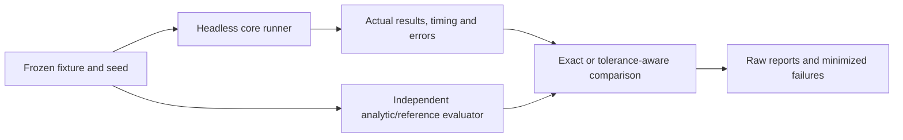

# Independent oracles fixtures and failure harness

Use analytic motion, elastic circles, sliding friction, ten-box stack, pendulum, ten-link bridge, motor crank and kinematic-platform scenes. Freeze shapes, materials, iterations and settling period before acceptance.

Analytic fixtures use closed-form discrete free fall and isolated collision/mass formulas. Broad-phase oracle scans independently; required tolerances apply only to their declared physical assumptions. Collect failed numerical scenes with exact settings.

1,000 awake dynamic circles/boxes with <=2,000 persistent contact points; p95 headless step <=16.7 ms over 3,600 ticks after 600 warm-up ticks; <=512 MiB application memory. Campaigns: 10,000 small scenes, 1,000 CCD launches and twenty deterministic repeat/continuation runs.

Faults exercise only owned files/processes. Interrupt staged artifact publication and challenge corrupt/incompatible files. Quotas stop work explicitly. Independent tests cover known bad outputs so an oracle cannot pass merely by sharing the same bug. Reports retain commands, configuration, seed/build, actual measurements, raw counterexamples and limitations. All execution results are NOT RUN.
